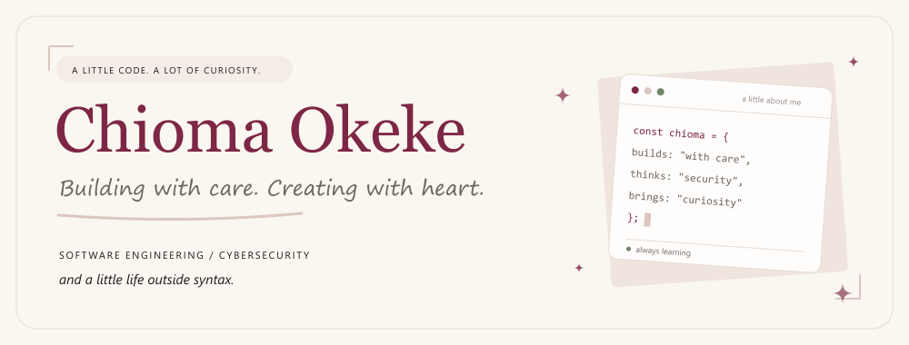
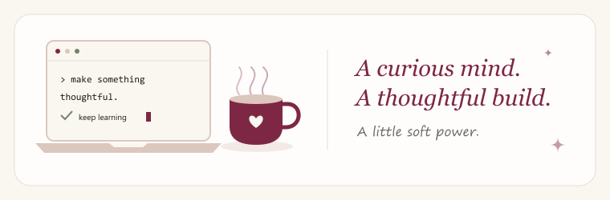

<div align="center">
  <h1>🌷 Chummy Codes</h1>
  <p><strong>Thoughtful software. A security-first mindset. A little soft power.</strong></p>
  <p>💻 Software engineering &nbsp; · &nbsp; 🔐 Cybersecurity &nbsp; · &nbsp; 📷 Life outside syntax</p>
  <p>
    <a href="https://www.linkedin.com/in/okeke-chioma">💼 LinkedIn</a> &nbsp; · &nbsp;
    <a href="https://github.com/Chioma-Okeke">🐙 GitHub</a> &nbsp; · &nbsp;
    <a href="mailto:okekegeraldenne@gmail.com">💌 Say hello</a> &nbsp; · &nbsp;
    <a href="public/resume.pdf">📄 Resume</a>
  </p>
</div>

## 👋 Hey, I'm Chioma

Software engineer, M.S. Computer Science student at **Arizona State University**, and a curious human who cares about how software works *and* how it makes people feel.

This is my corner of the internet: a home for the things I build, the security questions I explore, and the moments I collect away from my keyboard. Think **cream paper, wine accents, handwritten notes, and project deep dives**. A portfolio with a scrapbook soul. ✨

> 🌿 My kind of soft power: care in the details, curiosity in the process, and software built around people.

## 🧭 Pick a door, take a look around

| Stop by | What's waiting for you |
| --- | --- |
| 🏡 **Home** · `/` | A hello, selected projects, and a glimpse of the person behind the code. |
| 💻 **Work** · `/work` | Filterable engineering, security, and experimental projects. |
| 🔎 **Case studies** · `/work/[slug]` | The why, the architecture, the challenges, and the lessons. |
| 🌷 **About** · `/about` | My background, experience, and engineering philosophy. |
| 📷 **Life Outside Syntax** · `/life-outside-syntax` | Travel, photographs, and current favorites. |
| 💌 **Contact** · `/contact` | A place to start a conversation, powered by Resend. |

Little details I love: responsive layouts, gentle scroll reveals that respect reduced-motion preferences, a downloadable resume, and a custom Open Graph image for shared links. 🪄

## 🧪 Things I've been building & exploring

| Project | The story |
| --- | --- |
| 🧺 **Laundry Inventory Management System** | Bringing customers, orders, and item tracking into one role-based workflow. |
| 🌱 **CarbonLint** | Exploring faster code with a smaller footprint. |
| 🛡️ **LLM Context Integrity** | Researching prompt-injection defenses for LLM-enabled smart homes. |
| 🔐 **AgentTrust** · *In development* | Building AI-agent security and governance for the PayPal AI Hackathon, with spending and authorization policies checked before financial actions execute. |
| 🤝 **BridgeUp** | Bringing peer accountability and campus resources into Canvas for first-generation students. |
| 🤖 **AI-Assisted Salesforce Code Review** | Combining deterministic checks and AI analysis across quality and security gates. |

The laundry platform, CarbonLint, and LLM Context Integrity get a spot on the home page. Every project has a story on the Work page. 📖

## 🛠️ The ingredients

| Area | Tools |
| --- | --- |
| ⚡ Framework | Next.js 16 App Router, React 19, TypeScript |
| 🎨 Styling | Tailwind CSS v4, shadcn/ui, Base UI |
| 🪄 Animation and icons | Motion, Lucide React |
| 💌 Contact form | Next.js Server Actions, Zod, Resend |
| ✍️ Typography | Cormorant Garamond, Manrope, Caveat via `next/font` |
| 🧹 Code quality | ESLint |

Content lives in typed TypeScript modules under `content/`; no CMS or database is required for the portfolio itself.

## 🚀 Make yourself at home

Bring **Node.js 20.9 or newer**, **npm**, and your curiosity. ☕

```bash
git clone https://github.com/Chioma-Okeke/chummy-codes.git
cd chummy-codes
npm ci
npm run dev
```

Open [localhost:3000](http://localhost:3000). To enable contact-form delivery, configure the environment variables below and restart the development server.

### 💌 Give the contact form an inbox

Copy `.env.example` to `.env.local` in the project root and fill in:

| Variable | Purpose |
| --- | --- |
| `RESEND_API_KEY` | Resend API key; required to send messages. |
| `CONTACT_TO_EMAIL` | Inbox that receives contact messages; required to send messages. |
| `CONTACT_FROM_EMAIL` | Optional sender address. When unset, the code uses `Portfolio <onboarding@resend.dev>`. |

Replace the example `CONTACT_FROM_EMAIL` with a sender on a domain verified in Resend for production, or remove it to use the default test sender. These variables are used only on the server.

The site can run without email credentials. Until the required variables are set, the form displays a configuration message with a direct email link.

The form includes server-side Zod validation, a honeypot field, and sending and success states. ✨

### 📸 Bring your own photo album

Personal photographs and project screenshots in `public/me/`, `public/LaundryInventory/`, `public/bridgeUp/`, and `public/carbonLint/` are intentionally excluded from Git. Add those assets locally or update the image paths in `content/` to use your own files. An image path that points to a missing file will not load; optional images set to `undefined` use the built-in placeholders.

## 🎛️ The control panel

| Command | Purpose |
| --- | --- |
| `npm run dev` | Start the development server. |
| `npm run lint` | Run ESLint. |
| `npm run build` | Create a production build. |
| `npm run start` | Serve the production build after running `npm run build`. |

## 🗂️ A peek behind the curtain

<details>
<summary><strong>🧵 Follow the folders</strong></summary>


```text
app/
  page.tsx                  Home page
  about/                    Background and experience
  work/                     Project listing and /work/[slug] case studies
  life-outside-syntax/       Personal scrapbook
  contact/                  Contact page, form, and email Server Action
  layout.tsx                Shared layout, fonts, and site metadata
  globals.css               Theme tokens and global styles
  opengraph-image.tsx        Generated social sharing image
components/
  site/                     Navigation, footer, photos, and project artwork
  motion/                   Shared animation components
  diagrams/                 Project architecture diagrams
  ui/                       Reusable UI primitives
content/                    Site details, projects, about, and scrapbook content
assets/fonts/               Local fonts used by the Open Graph image
public/                     Resume and static assets
designs/                    Desktop and mobile design references
docs/readme/                Custom README GIFs and their source generator
```

</details>

## 🎨 Make it yours

- 🪪 **Identity, navigation, and links:** edit `content/site.ts`.
- 💻 **Projects:** edit `content/projects.ts`. Set `featured: true` to show a project on the home page; add `caseStudy` content to give it a page at `/work/<slug>`.
- 🌷 **Background and experience:** edit `content/about.ts`.
- 📷 **Scrapbook and personal content:** edit `content/life.ts`.
- 📄 **Resume:** replace `public/resume.pdf`.
- 🎨 **Colors and typography:** edit `app/globals.css` and the font setup in `app/layout.tsx`.

## ☁️ Send it out into the world

The contact form uses a Server Action, so deploy with a Next.js server runtime, such as Vercel or a Node.js host. For a Node.js deployment, run `npm run build`, then `npm run start`.

Automatic Git deployments are disabled in `vercel.json`. For a manual Vercel deployment, set the contact-form variables in the project's Vercel environment settings, then run:

```bash
npx vercel --prod
```

Deploy from a local checkout containing the photographs and screenshots. `.vercelignore` excludes private documents, design references, selected original images, and local environment files from the upload.

<details>
<summary><strong>🎞️ About the little animations</strong></summary>

Both GIFs are custom-made for this README using the site's cream-and-wine palette. The files live in `docs/readme/`, alongside their source generator. To redraw them after changing the artwork, run this from the repository root with dependencies installed:

```bash
node docs/readme/generate-assets.mjs
```

The generator uses the Sharp installation bundled with Next.js. Fonts use the available system serif, sans-serif, and handwritten families, so rendering can vary across machines.

The animations use standard Markdown image links so VS Code's Markdown preview can resolve their local paths. You can also open the [portfolio banner](./docs/readme/portfolio-banner.gif) or [coffee-and-code GIF](./docs/readme/coffee-and-code.gif) directly.

</details>

---



<div align="center">
  <h3>💌 Good things often start with a hello.</h3>
  <p>Have a project in mind, a security question, or a story to swap?</p>
  <p><a href="mailto:okekegeraldenne@gmail.com"><strong>Let's talk →</strong></a></p>
  <p>Made with curiosity, care, and a few handwritten notes. 🌷</p>
</div>
